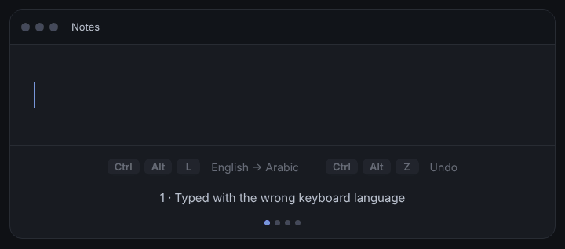

# Keyboard Flip

**Typed in the wrong keyboard language? Fix it in one keystroke.**

Select the text, press a shortcut, and Keyboard Flip converts it in place, like `hello` → `اثممخ` and back again. It is not a translator: it re-types the same key presses on another keyboard layout.

Free, open source, and runs fully offline. Windows 10 / 11.



## Download

1. Go to the [latest release](../../releases/latest).
2. Download **KeyboardFlip_Setup.exe** and run it.

If Windows shows *"Windows protected your PC"*, click **More info**, then **Run anyway**. The app is not code-signed yet, and all of the source is here for you to read.

## How it works

1. Select the text you typed in the wrong language. (Nothing selected? It converts the last word.)
2. Press your shortcut.
3. The text is replaced where it was, and your clipboard is restored.

Converted by mistake? Press the undo shortcut (up to 10 times in a row).

## Features

- **14 languages:** Arabic, English, German, French, Spanish, Russian (on by default) plus Turkish, Ukrainian, Persian, Hindi, Urdu, Italian, Portuguese, Greek (turn them on in the Keyboards tab)
- **Keyboard layouts:** choose the layout you type on (for example English US/UK, Arabic 101/102, Spanish Spain/Latin America)
- **Up to 10 conversion shortcuts**, each with its own key combination, and **both ways** detection between languages with different alphabets
- **Change letter case** with one shortcut: UPPER → Sentence case → lower
- **Snippets:** your saved texts (email, phone...) pasted from a small menu
- **Preview** the result before it replaces your text (off by default)
- **Double-tap Shift or Ctrl** to run a conversion (off by default)
- **Undo** up to 10 conversions, and a **History** tab (saved on your PC only while the program runs)
- **Excluded programs:** never convert inside apps you choose
- **System tray app**, optional start with Windows, light / dark / Midnight / Sand themes, accent colors
- **Interface in 6 languages:** English, Arabic, German, French, Spanish, Russian
- **Private:** see [Privacy](#privacy)

### Default shortcuts

| Shortcut | Action |
| --- | --- |
| `Ctrl` + `Alt` + `L` | English → Arabic |
| `Ctrl` + `Alt` + `K` | Arabic → English |
| `Ctrl` + `Alt` + `Z` | Undo last conversion |
| `Ctrl` + `Alt` + `U` | Change letter case |
| `Ctrl` + `Alt` + `S` | Snippets menu |

You can change all of them inside the app.

## Privacy

- No telemetry, no account, and your text never leaves your computer.
- The program sends no data to other systems. The **only** optional exception is the update check: if you turn it on in Settings (it is **off** by default), it asks GitHub once a day for the latest version number and sends nothing else. It never downloads or installs anything by itself.
- History is saved in `%APPDATA%\KeyboardFlip\history.json` only while the program runs, and is deleted when you quit it completely. Your snippets and settings are stored in `%APPDATA%\KeyboardFlip\config.json`.

## Run from source

Requires Windows and Python 3.10 or newer.

```bat
pip install -r requirements.txt
python main.py
```

Or double-click `run_dev.bat`.

## Build the installer

Double-click **`build.bat`**. It installs the build tools, builds `KeyboardFlip.exe` with PyInstaller, and creates the installer with Inno Setup (it installs Inno Setup with `winget` if needed).

The result is `installer_output\KeyboardFlip_Setup.exe`. Upload it to a GitHub Release. The installer also creates the uninstaller (Settings → Apps → Keyboard Flip).

Leftovers from old script versions can be removed with `Remove_Old_Versions.bat`.

### Optional: build and sign on GitHub

`.github/workflows/release.yml` builds the same installer on GitHub when you push a tag such as `v1.1.0`, and creates a **draft** release for you to check and publish. It is also the base for free code signing through SignPath (see below). It does nothing until you push a tag.

## Code signing policy

Free code signing provided by [SignPath.io](https://signpath.io), certificate by [SignPath Foundation](https://signpath.org).

*(Signing is being set up. Until the first signed release, the installer is unsigned.)*

- **Team roles:** author, reviewer and approver: [@yousseifindx5](https://github.com/yousseifindx5) (project owner). Every release is approved manually before it is signed.
- **Built from source on GitHub:** signed files are only produced by `.github/workflows/release.yml` from the code in this repository.
- **Privacy:** see [Privacy](#privacy). The program sends no data to other systems unless you turn on the optional update check.

## Project structure

```
main.py                 entry point (tray icon, single instance)
keyboardflip/
  engine.py             shortcut → copy → change → paste, undo, history
  layouts.py            keyboard layouts and conversion logic
  textcase.py           UPPER / Sentence / lower cycle
  winapi.py             Windows API: hotkeys, clipboard, key sending, double-tap
  ui.py                 main window (CustomTkinter)
  widgets.py            colors, themes, small widgets, shortcut recorder
  popups.py             preview box, snippets menu, welcome tour
  updates.py            optional update check
  config.py, i18n.py    settings and interface texts
  locales/              one file per interface language
  log.py                writes errors to error.log
tests/                  unit tests (they don't need Windows)
assets/                 logo (icon.png, icon.ico)
docs/                   demo animation
website/                landing page (English + Arabic, deployed on Vercel)
build.bat, installer.iss, .github/workflows/
```

To add or fix a keyboard layout, see `keyboardflip/layouts.py`. To add an interface language, copy `keyboardflip/locales/en.py`, translate it, and add one line in `keyboardflip/i18n.py`.

## Good to know

- Programs running as **Administrator** ignore Keyboard Flip unless you run it as Administrator too.
- Only text on the clipboard is restored afterwards; copied images or files are not.
- The Arabic letters `لا` can be typed with one key or two, so Arabic → English picks the reading that looks most like English. It can be wrong on rare words.
- The new languages read their key layout from Windows itself, so they work when that layout exists on your PC.
- Settings are stored in `%APPDATA%\KeyboardFlip\config.json`. Errors are logged to `error.log` in the same folder.

## Contributing

Ideas, bug reports, and pull requests are welcome. Please open an [issue](../../issues) first for bigger changes.

Before sending a pull request, run the tests (they don't need Windows):

```bash
python -m unittest discover -s tests -v
```

If Keyboard Flip saves you time, a ⭐ on the repo is the nicest thank you.

## License

Keyboard Flip is free and open source, released under the [MIT License](LICENSE).

You are free to use, study, share, and modify it.
